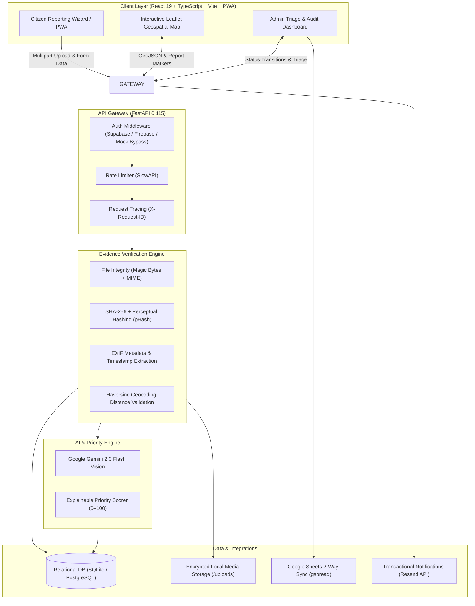

# CivicPulse AI — Public Problem Priority Engine & Evidence Verification Platform

<div align="center">


[](https://opensource.org/licenses/MIT)
[](https://python.org)
[](https://fastapi.tiangolo.com)
[](https://react.dev)
[](https://www.typescriptlang.org)
[](https://ai.google.dev)
[](backend/tests)
[](frontend)

**An evidence-driven, AI-augmented civic grievance reporting and municipal triage ecosystem designed for Indian cities, with specialized geospatial intelligence across Andhra Pradesh.**

[Live Application Demo](https://civic-plus-six.vercel.app) • [API Documentation (Swagger)](http://127.0.0.1:8000/docs) • [Report Bug / Issue](https://github.com/Nishu457/Civic-plus-/issues)

</div>

---

## 📋 Table of Contents

- [Overview & Problem Statement](#-overview--problem-statement)
- [System Architecture](#-system-architecture)
- [Key Features](#-key-features)
  - [1. 5-Step Citizen Reporting Wizard](#1-5-step-citizen-reporting-wizard)
  - [2. Multi-Layer Evidence & Anti-Spam Pipeline](#2-multi-layer-evidence--anti-spam-pipeline)
  - [3. Google Gemini 2.0 Flash Vision AI](#3-google-gemini-20-flash-vision-ai)
  - [4. Explainable 0–100 Priority Engine](#4-explainable-0100-priority-engine)
  - [5. Interactive Geospatial Map (Leaflet)](#5-interactive-geospatial-map-leaflet)
  - [6. Admin Governance & Triage Dashboard](#6-admin-governance--triage-dashboard)
  - [7. Authentication & PWA Offline Support](#7-authentication--pwa-offline-support)
- [Technology Stack](#-technology-stack)
- [Repository Structure](#-repository-structure)
- [Getting Started](#-getting-started)
  - [Prerequisites](#prerequisites)
  - [Quick Start (Root Workspace Runner)](#quick-start-root-workspace-runner)
  - [Manual Backend Setup](#manual-backend-setup)
  - [Manual Frontend Setup](#manual-frontend-setup)
  - [Docker Compose Deployment](#docker-compose-deployment)
- [Environment Variables](#-environment-variables)
- [Automated Testing & QA](#-automated-testing--qa)
- [API Reference](#-api-reference)
- [Core Principles & Ethical Guardrails](#-core-principles--ethical-guardrails)
- [Contributing](#-contributing)
- [License](#-license)

---

## 🌟 Overview & Problem Statement

Urban local bodies (ULBs) and municipal corporations across India face severe bottlenecks in handling public complaints:
1. **Duplicate Flood**: Hundreds of uncoordinated citizens report the same pothole, drain breach, or garbage pile with different angles and descriptions.
2. **Spam & False Reports**: Stock images, edited media, or irrelevant complaints waste critical municipal workforce hours.
3. **Black-Box Triage**: Complaints sit in opaque backlogs with no objective urgency metric, causing life-threatening hazards to be treated with the same urgency as minor cosmetic flaws.
4. **No Transparent Verification**: Citizens receive arbitrary rejections without knowing why their evidence was insufficient.

**CivicPulse AI** solves this with a **transparent, evidence-verified priority engine**. By combining cryptographic image hashing, perceptual pHash duplicate detection, camera EXIF spatial verification, Google Gemini 2.0 Flash multimodal visual analysis, and a deterministic 0–100 mathematical scoring formula, CivicPulse AI ensures that critical civic emergencies (such as open manholes, cave-ins, and high-voltage wire collapses) are prioritized and dispatched within minutes to the appropriate municipal department.

---

## 🏗️ System Architecture



---

## 🚀 Key Features

### 1. 5-Step Citizen Reporting Wizard
- **Step 1: Category Selection**: 8 specialized categories with localized Indian civic taxonomy:
  - Potholes & Damaged Roads
  - Drainage Overflow & Blocked Drains
  - Garbage Dumping & Unattended Waste
  - Waterlogging & Stagnant Water
  - Broken Streetlights & Electrical Hazards
  - Damaged Public Infrastructure
  - Sewage Leakage & Pipeline Rupture
  - Other Civic Grievances
- **Step 2: Evidence Capture**: Direct smartphone camera stream or high-resolution file picker with instant client-side preview.
- **Step 3: Geolocation Pinning**: High-accuracy browser GPS with circular accuracy radius meter, or interactive draggable map pin fallback.
- **Step 4: Issue Context & Safety Assessment**: Title, rich description, observed severity rating (`low`, `medium`, `high`, `critical`), nearest landmark, and **Immediate Public Safety Risk** toggle.
- **Step 5: Transparent Consent**: User review with clear privacy declaration, location consent, and audit consent before submission.

### 2. Multi-Layer Evidence & Anti-Spam Pipeline
Located in `app.services.evidence`:
- **File Integrity & Format Validation**: Enforces exact magic byte inspection (`\xff\xd8\xff` for JPEG, `\x89PNG\r\n\x1a\n` for PNG, `RIFF` for WebP). Blocks manipulated extensions and oversized payloads (>10MB).
- **Cryptographic & Perceptual Hashing**:
  - `SHA-256`: Detects exact binary duplicate files.
  - `imagehash.phash` (Perceptual Image Hash): Computes a 64-bit structural visual fingerprint to identify re-compressed, cropped, or slightly adjusted duplicate submissions across recent tickets.
- **EXIF Metadata & Hardware Analysis**: Parses camera manufacturer, model, software, original capture timestamp, and hardware GPS tags via `exifread`.
- **Haversine Distance Consistency Check**: Calculates geographic distance in meters between photo EXIF coordinates and citizen-reported location pin. If discrepancy exceeds 1,000 meters, flags an advisory notice for admin inspection.
- **Human-Centric Evidence Design**: **Missing EXIF is never treated as fraud**, acknowledging that popular messaging apps (WhatsApp, Telegram) scrub metadata on transit.

### 3. Google Gemini 2.0 Flash Vision AI
Located in `app.services.gemini`:
- Analyzes uploaded imagery using Google's multimodal **Gemini 2.0 Flash** model.
- Strictly validated JSON output structured according to application schemas:
  - Visual category detection
  - Factual visual description (2–3 concise sentences)
  - Severity estimation based on visible physical evidence
  - Confidence rating (`low`, `medium`, `high`)
  - Relevance verification against user-selected category (filters out selfies, documents, or unrelated photos)
  - Automated `requires_human_review` flags with explanations

### 4. Explainable 0–100 Priority Engine
Located in `app.services.priority`:
The priority engine calculates an objective 0–100 score using deterministic, transparent rules with zero black-box bias:

$$\text{Priority Score} = S_{\text{safety}} + S_{\text{severity}} + S_{\text{evidence}} + S_{\text{density}} + S_{\text{recency}} + S_{\text{ai}}$$

| Component | Max Points | Evaluation Logic |
|---|:---:|---|
| **Public Safety Risk** | **30** | `+30` if citizen flags immediate danger to human life/injury; `0` otherwise |
| **Observed Severity** | **20** | `Critical: 20` • `High: 15` • `Medium: 10` • `Low: 5` |
| **Evidence Quality** | **15** | `Photo provided: +5` • `GPS verified: +7` (or manual pin: `+5`) • `Low evidence risk: +3` |
| **Geographic Density** | **15** | Cluster detection: counts independent verified reports within ~1 km in the last 30 days (`+3` to `+15`) |
| **Recency & Age** | **10** | Boosts unresolved reports that have been lingering unattended |
| **AI Visual Severity Boost** | **10** | `+10` if Gemini confirms visual critical hazard |

#### Priority Bands & SLA Targets
- **Critical (81–100)**: Immediate life hazard or major arterial infrastructure failure. Urgent same-day human dispatch.
- **High (61–80)**: Severe public disruption or contamination risk. 24–48 hour municipal target.
- **Medium (31–60)**: Standard urban maintenance grievance.
- **Low (0–30)**: Cosmetic or minor localized defect.

### 5. Interactive Geospatial Map (Leaflet)
- Integrated Leaflet / OpenStreetMap visualizer focusing on Andhra Pradesh cities: **Vijayawada, Visakhapatnam, Guntur, Tirupati, Amaravati, Rajahmundry, Kurnool, Nellore, and Kakinada**.
- Dynamically rendered pins colored by priority score.
- Instant preview cards with deep links to full evidence breakdowns.
- Real-time client-side filters for Category, Severity, Status, and Minimum Priority threshold.

### 6. Admin Governance & Triage Dashboard
- **Executive Metric Cards**: Real-time totals for Active Complaints, Pending Review, Average Priority Score, and Google Sheets Sync status.
- **Status State Machine**:
  $$\text{submitted} \longrightarrow \text{under\_review} \longrightarrow \text{forwarded} \longrightarrow \text{acknowledged} \longrightarrow \text{in\_progress} \longrightarrow \text{resolved} \lor \text{rejected}$$
- **Authority Delegation**: Assigns actionable responsibility to real municipal entities (e.g., *Vijayawada Municipal Corporation - Roads Division*, *GVMC Health & Sanitation*, *AP Discom - Electrical Safety*).
- **Immutable Administrative Audit Trail**: Every status modification, assigned authority change, and rejection reason is permanently recorded in the `AdminAuditLog` table with timestamp, admin ID, and action payload.
- **Google Sheets Two-Way Sync**: 1-click synchronization using `gspread` service account to keep spreadsheet records synchronized for field staff.
- **Transactional Email Dispatch**: Integration with Resend API for official email alerts upon dispatch and resolution.

### 7. Authentication & PWA Offline Support
- **Dual-Mode Auth**: Supports Supabase Email OTP and Firebase Phone SMS OTP.
- **One-Click Demo Access**: Built-in `Demo Citizen` and `Demo Admin` bypasses allow full local evaluation and grading without live SMS / external API credentials.
- **PWA Ready**: Registered Service Worker (`vite-plugin-pwa`) enables caching, offline map display, and home-screen installability on mobile devices.

---

## 🛠️ Technology Stack

| Layer | Technology | Details |
|---|---|---|
| **Frontend Framework** | **React 19.2** + **TypeScript** | Ultra-responsive modern UI built with Vite 8 |
| **Styling** | **Tailwind CSS v4.3** | High-performance CSS engine with custom utility design system |
| **Routing** | **React Router v7** | Client-side routing with nested layouts and route protection |
| **Mapping & GIS** | **Leaflet** + **React-Leaflet v5** | Lightweight OpenStreetMap visualization and geo-pinning |
| **Icons & Assets** | **Lucide React** | Modern, accessible SVG iconography |
| **Backend Framework** | **FastAPI 0.115** + **Python 3.12** | High-throughput asynchronous ASGI web server |
| **Database ORM** | **SQLAlchemy 2.0** + **AioSQLite** | Asynchronous ORM with relational integrity and indices |
| **AI / Multimodal** | **Google Gemini 2.0 Flash** | Fast visual classification and structured JSON analysis |
| **Image Analysis** | **Pillow 10.4** + **ImageHash 4.3** + **ExifRead 3.0** | Perceptual pHash hashing, EXIF extraction, and magic byte checking |
| **Auth & Identity** | **Supabase Auth** / **Firebase Admin SDK** | Email magic link / SMS OTP authentication |
| **Cloud Sync** | **Google Sheets API (`gspread`)** | Automated field-worker spreadsheet export |
| **Notifications** | **Resend API 2.4** | Clean transactional email confirmations |
| **Testing** | **Pytest 8.3** + **Pytest-Asyncio** | Automated API, priority calculation, and schema test suites |
| **Containerization** | **Docker** & **Docker Compose** | Multi-container production deployment setup |

---

## 📂 Repository Structure

```text
Civic-plus-/
├── backend/                        # FastAPI Backend Application
│   ├── app/
│   │   ├── api/                    # Route handlers
│   │   │   ├── admin.py            # Admin triage, metrics, sync, audit logs
│   │   │   ├── health.py           # Health checks & public client config
│   │   │   └── reports.py          # Report submission, listing, detail, timeline
│   │   ├── core/                   # Application core
│   │   │   ├── config.py           # Pydantic v2 Settings & environment parsing
│   │   │   ├── database.py         # SQLAlchemy engine, session maker, DB initialization
│   │   │   └── security.py         # Firebase Admin & Supabase token verification
│   │   ├── models/                 # SQLAlchemy ORM models
│   │   │   └── report.py           # Report, EvidenceCheck, StatusHistory, AdminAuditLog
│   │   ├── schemas/                # Pydantic validation schemas
│   │   │   └── report.py           # Request/response DTOs, priority breakdowns
│   │   ├── services/               # Business logic services
│   │   │   ├── email.py            # Resend email notification service
│   │   │   ├── evidence.py         # Multi-layer image, EXIF & pHash pipeline
│   │   │   ├── gemini.py           # Google Gemini 2.0 Flash integration
│   │   │   ├── priority.py         # Deterministic 0-100 priority scoring engine
│   │   │   └── sheets.py           # Google Sheets bi-directional sync
│   │   └── main.py                 # FastAPI application factory, CORS, static mounts
│   ├── tests/                      # Automated test suite
│   │   └── test_api.py             # 7 end-to-end integration test suites
│   ├── Dockerfile                  # Production container definition for backend
│   ├── requirements.txt            # Locked Python dependencies
│   └── seed_data.py                # Realistic Andhra Pradesh civic issues seeder
├── frontend/                       # React 19 + TypeScript + Vite SPA
│   ├── public/                     # Static icons, manifest, favicon
│   ├── src/
│   │   ├── components/             # Reusable UI components (Navbar, Footer, Badges)
│   │   ├── hooks/                  # Custom React hooks (useAuth context)
│   │   ├── pages/                  # Top-level application views
│   │   │   ├── AdminDashboard.tsx  # Admin triage, filters, sheets sync, audit trail
│   │   │   ├── ExploreIssues.tsx   # Card/list view of civic issues with filters
│   │   │   ├── Landing.tsx         # Modern landing hero, stats, live preview
│   │   │   ├── Login.tsx           # Supabase Email OTP & 1-click Demo auth
│   │   │   ├── MapView.tsx         # Leaflet interactive map with AP coordinates
│   │   │   ├── MyReports.tsx       # Citizen personal report tracking
│   │   │   ├── Profile.tsx         # Citizen user profile and activity stats
│   │   │   ├── ReportDetail.tsx    # Full transparent report view & evidence breakdown
│   │   │   └── ReportIssue.tsx     # 5-step guided reporting wizard
│   │   ├── services/               # Axios API client, Firebase & Supabase configs
│   │   ├── types/                  # TypeScript interface definitions
│   │   ├── App.tsx                 # Route declarations & route guards
│   │   ├── index.css               # Tailwind CSS v4 design tokens and utilities
│   │   └── main.tsx                # React root mount
│   ├── Dockerfile                  # Nginx + multi-stage Vite production container
│   ├── nginx.conf                  # Nginx production reverse proxy config
│   ├── package.json                # Frontend scripts and dependencies
│   ├── tsconfig.json               # TypeScript configuration
│   └── vite.config.ts              # Vite 8 config with Tailwind v4 & PWA
├── docker-compose.yml              # Multi-container orchestration
├── package.json                    # Root workspace runner scripts
└── README.md                       # Complete documentation
```

---

## ⚡ Getting Started

### Prerequisites
- **Python**: `3.11` or `3.12` installed ([python.org](https://www.python.org/downloads/))
- **Node.js**: `v18.0.0` or higher & `npm` ([nodejs.org](https://nodejs.org/))
- **Git**
- *(Optional)* **Docker & Docker Compose** for containerized execution

---

### Quick Start (Root Workspace Runner)

CivicPulse AI includes convenient root scripts to manage both services:

```bash
# Clone the repository
git clone https://github.com/Nishu457/Civic-plus-.git
cd Civic-plus-

# Install root dependencies
npm install

# Setup and run backend
npm run backend

# In a second terminal, run frontend
npm run dev
```

---

### Manual Backend Setup

1. **Navigate to backend and create virtual environment**:
   ```bash
   cd backend
   python -m venv .venv
   ```

2. **Activate the virtual environment**:
   - **Windows PowerShell**:
     ```powershell
     .\.venv\Scripts\Activate.ps1
     ```
   - **Linux / macOS**:
     ```bash
     source .venv/bin/activate
     ```

3. **Install dependencies**:
   ```bash
   pip install -r requirements.txt
   ```

4. **Initialize database & seed realistic test data**:
   ```powershell
   $env:PYTHONPATH="."
   python seed_data.py
   ```
   *(On Linux/macOS: `PYTHONPATH=. python seed_data.py`)*

   > This populates the database with 10 realistic civic issues across Vijayawada, Visakhapatnam, Guntur, and Tirupati, complete with calculated priorities and evidence checks.

5. **Start FastAPI development server**:
   ```bash
   uvicorn app.main:app --host 127.0.0.1 --port 8000 --reload
   ```

   - **API Base**: `http://127.0.0.1:8000`
   - **Interactive OpenAPI Docs**: `http://127.0.0.1:8000/docs`
   - **Health Check**: `http://127.0.0.1:8000/health`

---

### Manual Frontend Setup

1. **Navigate to frontend directory**:
   ```bash
   cd frontend
   ```

2. **Install frontend dependencies**:
   ```bash
   npm install
   ```

3. **Run TypeScript check & build verification**:
   ```bash
   npm run build
   ```

4. **Start Vite development server**:
   ```bash
   npm run dev
   ```

   - **Frontend App**: `http://127.0.0.1:5173`

---

### Docker Compose Deployment

To build and run both the FastAPI backend and Nginx-powered React frontend in production containers:

```bash
docker compose up --build -d
```

- **Frontend Application**: `http://localhost:5173`
- **Backend API**: `http://localhost:8000`
- **Swagger Documentation**: `http://localhost:8000/docs`

To stop the containers:
```bash
docker compose down
```

---

## 🔐 Environment Variables

Create a `.env` file in the root or `backend/` directory based on `.env.example`:

| Variable | Required | Default | Description |
|---|:---:|---|---|
| `APP_ENV` | Optional | `development` | Environment mode (`development` / `production`) |
| `APP_SECRET_KEY` | **Yes** | `CHANGEME` | Secret key used for cryptographic hashing and sessions |
| `APP_DEBUG` | Optional | `true` | Enables verbose debug logging and stack trace output |
| `BACKEND_PORT` | Optional | `8000` | Port for the FastAPI Uvicorn server |
| `FRONTEND_URL` | Optional | `http://localhost:5173` | Allowed CORS origin for frontend requests |
| `DATABASE_URL` | Optional | `sqlite:///./civicpulse.db` | SQLAlchemy connection string (SQLite or PostgreSQL) |
| `GEMINI_API_KEY` | Optional | `""` | Google AI Studio API key for Gemini 2.0 Flash Vision |
| `GEMINI_MODEL` | Optional | `gemini-2.0-flash` | Gemini model variant |
| `VITE_SUPABASE_URL` | Optional | `""` | Supabase Project URL for Email OTP authentication |
| `VITE_SUPABASE_PUBLISHABLE_KEY` | Optional | `""` | Supabase Anon/Public Key for browser client |
| `FIREBASE_PROJECT_ID` | Optional | `""` | Firebase project ID for Phone OTP authentication |
| `FIREBASE_SERVICE_ACCOUNT_PATH` | Optional | `./firebase-service-account.json` | Path to Firebase Admin SDK service account key |
| `GOOGLE_SHEETS_SPREADSHEET_ID`| Optional | `""` | Google Sheet ID for real-time field triage sync |
| `GOOGLE_SHEETS_SERVICE_ACCOUNT_PATH`| Optional | `./google-sheets-service-account.json`| Path to Google Cloud Service Account credentials |
| `RESEND_API_KEY` | Optional | `""` | Resend API key for sending confirmation emails |
| `UPLOAD_DIR` | Optional | `./uploads` | Local directory for storing citizen uploaded media |
| `MAX_UPLOAD_SIZE_MB` | Optional | `10` | Maximum allowed upload size in megabytes |
| `RATE_LIMIT_REPORTS_PER_HOUR`| Optional | `10` | IP rate limit for report submissions |

> 💡 **Frictionless Evaluation**: If API keys (`GEMINI_API_KEY`, `FIREBASE_*`, `GOOGLE_SHEETS_*`) are not provided, CivicPulse AI **gracefully degrades**. The built-in Demo Citizen and Demo Admin logins work out of the box, and priority scoring operates smoothly using deterministic baseline signals.

---

## 🧪 Automated Testing & QA

CivicPulse AI includes an automated test suite covering endpoints, priority calculations, data validation, file uploads, and admin operations.

Run the tests using pytest inside the backend virtual environment:

```powershell
cd backend
$env:PYTHONPATH="."
.\.venv\Scripts\pytest tests -v
```

*(On Linux / macOS)*:
```bash
cd backend
PYTHONPATH=. .venv/bin/pytest tests -v
```

### Test Suite Coverage

```text
tests/test_api.py::test_health PASSED                                    [  4%]
tests/test_api.py::test_public_config PASSED                             [  9%]
tests/test_api.py::test_create_and_fetch_report PASSED                   [ 14%]
tests/test_api.py::test_report_validation_errors PASSED                  [ 19%]
tests/test_api.py::test_priority_calculation PASSED                      [ 23%]
tests/test_api.py::test_admin_dashboard_and_status_update PASSED         [ 28%]
tests/test_api.py::test_image_upload_and_admin_retrieval PASSED          [ 33%]
tests/test_image_verification.py::test_scenario_1_clear_pothole PASSED   [ 38%]
tests/test_image_verification.py::test_scenario_2_overflowing_garbage PASSED [ 42%]
tests/test_image_verification.py::test_scenario_3_blocked_drainage PASSED [ 47%]
tests/test_image_verification.py::test_scenario_4_road_waterlogging PASSED [ 52%]
tests/test_image_verification.py::test_scenario_5_normal_road PASSED     [ 57%]
tests/test_image_verification.py::test_scenario_6_selfie PASSED          [ 61%]
tests/test_image_verification.py::test_scenario_7_food PASSED            [ 66%]
tests/test_image_verification.py::test_scenario_8_screenshot_document PASSED [ 71%]
tests/test_image_verification.py::test_scenario_9_blurred_or_dark PASSED [ 76%]
tests/test_image_verification.py::test_scenario_10_corrupted_file PASSED [ 80%]
tests/test_image_verification.py::test_scenario_11_api_timeout_or_error PASSED [ 85%]
tests/test_image_verification.py::test_scenario_12_backend_rejects_unverified_image PASSED [ 90%]
tests/test_image_verification.py::test_scenario_13_sha256_caching PASSED [ 95%]
tests/test_image_verification.py::test_verify_image_http_endpoint PASSED [100%]

======================= 21 passed in 6.88s ========================
```

---

## 📡 API Reference

Explore the interactive Swagger UI at `http://127.0.0.1:8000/docs` or ReDoc at `http://127.0.0.1:8000/redoc`.

### Core Endpoints

#### 1. System & Configuration
- `GET /health` — Returns status of backend services (database, AI, sheets, email).
- `GET /api/v1/config/public` — Returns safe public client configurations (no secret keys exposed).

#### 2. Public Reports & AI Verification
- `POST /api/v1/reports/verify-image` — Standalone multimodal AI verification analyzing image evidence with Google Gemini Flash-Lite. Enforces confidence thresholds and returns validation results without persisting records.
- `POST /api/v1/reports` — Submit a verified civic grievance with multipart image upload, verification token, coordinates, and details.
- `GET /api/v1/reports` — Query public reports with pagination, category filters, and status sorting.
- `GET /api/v1/reports/{report_id}` — Fetch comprehensive detail of a specific report.
- `GET /api/v1/reports/{report_id}/evidence` — Fetch evidence breakdown (EXIF metadata, duplicate status, AI findings, and distance check).
- `GET /api/v1/reports/{report_id}/timeline` — View complete chronological status history of the complaint.
- `GET /api/v1/reports/nearby` — Query issues near a specific latitude/longitude within a radius.

#### 3. Administrative Triage
- `GET /api/v1/admin/dashboard` — Summary analytics: total complaints, status breakdown, category distribution, and average priority score.
- `GET /api/v1/admin/reports` — Filtered admin triage list with evidence flags and priority scores.
- `PATCH /api/v1/admin/reports/{report_id}/status` — Transition report status, assign municipal authority, or record rejection reason.
- `POST /api/v1/admin/reports/sync-sheets` — Trigger synchronization with connected Google Sheet.
- `GET /api/v1/admin/audit-logs` — Fetch immutable administrative audit log records.

---

## 🛡️ Core Principles & Ethical Guardrails

1. **Supportive, Not Authoritative AI**:
   Google Gemini Vision outputs are treated as **supportive diagnostic signals**, never as sole arbiters of truth. AI never unilaterally rejects or deletes a citizen's complaint.
2. **Fairness for Non-Technical Users**:
   Camera metadata (EXIF) is frequently stripped by instant messaging platforms. CivicPulse AI explicitly treats missing EXIF as **inconclusive**, not fraudulent.
3. **Deterministic & Auditable Scoring**:
   The 0–100 priority score is calculated using transparent, published formulas. Citizens and administrators can inspect the exact breakdown of why a report received its score.
4. **Privacy-Preserving Architecture**:
   Phone numbers and personal identifiers are never stored in plaintext; user phone data is irreversibly hashed using SHA-256 for duplicate tracking while safeguarding citizen privacy.

---

## 🤝 Contributing

Contributions to CivicPulse AI are welcome! Follow these steps:

1. **Fork the repository**
2. **Create a feature branch**:
   ```bash
   git checkout -b feature/amazing-feature
   ```
3. **Commit your changes**:
   ```bash
   git commit -m "feat: add amazing feature"
   ```
4. **Run the test suite**:
   ```bash
   cd backend && python -m pytest tests -v
   cd ../frontend && npm run build
   ```
5. **Push to the branch**:
   ```bash
   git push origin feature/amazing-feature
   ```
6. **Open a Pull Request**

---

## 📄 License

Distributed under the **MIT License**. See `LICENSE` for more information.

Built with dedication for transparent civic governance, empowered communities, and responsive public infrastructure.